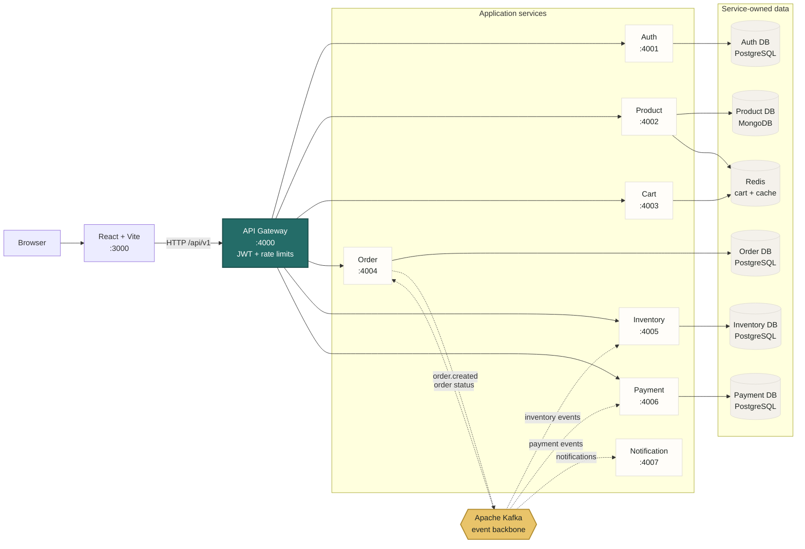

# 🛒 E-Commerce Microservices Platform

A production-grade, event-driven e-commerce platform built with **Node.js microservices**, **Apache Kafka**, **Redis**, **PostgreSQL**, **MongoDB**, and a **React** frontend — all orchestrated locally with **Docker Compose**.

> **Purpose**: This is a learning/reference project that demonstrates real-world microservices patterns: Saga choreography, idempotency keys, outbox pattern, cache-aside, circuit breakers, atomic stock reservation, structured logging with correlation IDs, and more.

---

## 🏗️ Architecture



**Checkout event flow:** `order.created` -> `inventory.reserved` ->
`payment.completed` -> order confirmation. Rejection or payment failure emits a
compensating event that releases inventory and cancels the order. Solid arrows
represent synchronous HTTP/data access; dotted arrows represent Kafka events.

Each service owns its data and communicates through the gateway for HTTP requests
and Kafka for asynchronous checkout events. Redis is shared by the cart service
and the product cache; PostgreSQL databases remain logically separated per service.

---

## 📦 Services

| Service | Port | Database | Description |
|---------|------|----------|-------------|
| **API Gateway** | 4000 | — | Reverse proxy, JWT validation, rate limiting, correlation IDs |
| **Auth Service** | 4001 | PostgreSQL | User registration, login, JWT issuance |
| **Product Service** | 4002 | MongoDB + Redis | Product catalog CRUD with cache-aside pattern |
| **Cart Service** | 4003 | Redis | Session-based shopping cart |
| **Order Service** | 4004 | PostgreSQL | Order lifecycle, state machine, outbox pattern |
| **Inventory Service** | 4005 | PostgreSQL | Stock management, atomic reservation |
| **Payment Service** | 4006 | PostgreSQL | Payment processing (simulated), idempotency keys |
| **Notification Service** | 4007 | — | Event consumer — logs email/SMS notifications |
| **Frontend** | 3000 | — | React + Vite SPA |

---

## 🛠️ Tech Stack

### Backend
| Technology | Version | Purpose |
|-----------|---------|---------|
| Node.js | 20 LTS | Runtime for all services |
| TypeScript | 7.0.2 (root), 5.3.3 (workspace tooling) | Static typing and compilation |
| Express | 4.x | HTTP framework |
| KafkaJS | 2.x | Apache Kafka client (producer/consumer) |
| Knex.js | 3.x | SQL query builder + migrations (PostgreSQL) |
| Mongoose | 9.x | MongoDB ODM |
| ioredis | 5.x | Redis client |
| jsonwebtoken | 9.x | JWT sign/verify |
| bcryptjs | 2.x | Password hashing |
| Pino | 9.x | Structured JSON logging |
| Joi | 17.x | Request validation |
| opossum | 8.x | Circuit breaker |
| Axios | 1.x | HTTP client for inter-service calls |
| http-proxy-middleware | 3.x | API Gateway reverse proxy |
| express-rate-limit | 7.x | Rate limiting |
| uuid | 9.x | Correlation IDs, idempotency keys |

### Frontend
| Technology | Version | Purpose |
|-----------|---------|---------|
| React | 18.3.1 | UI library |
| Vite | 5.4.1 | Build tool / dev server |
| TypeScript | 5.3.3 | Frontend type checking and build |
| React Router | 6.x | Client-side routing |
| Axios | 1.x | API calls |

### Infrastructure
| Technology | Version | Purpose |
|-----------|---------|---------|
| Docker | 24+ | Containerization |
| Docker Compose | 2.x | Local orchestration |
| Apache Kafka | 3.7 (KRaft) | Event streaming backbone (no Zookeeper) |
| PostgreSQL | 16 | Transactional databases |
| MongoDB | 7 | Product catalog database |
| Redis | 7 | Caching + cart sessions |

### Testing & Quality
| Technology | Purpose |
|-----------|---------|
| Jest | Unit & integration testing |
| Supertest | HTTP endpoint testing |
| ESLint | Linting |
| Prettier | Code formatting |

---

## 🚀 Quick Start

### Prerequisites

- [Docker Desktop](https://www.docker.com/products/docker-desktop/) (v24+)
- [Node.js](https://nodejs.org/) (v20 LTS) — only needed for local dev without Docker
- [Git](https://git-scm.com/)

### Run the Complete Platform with Docker Compose

The commands below start PostgreSQL, MongoDB, Redis, Kafka, all backend services,
the API gateway, Kafka UI, and the frontend. Run them from the repository root.

#### 1. Create the environment file

```bash
cp .env.example .env
```

PowerShell equivalent:

```powershell
Copy-Item .env.example .env
```

The values in `.env.example` use Docker Compose service names such as `postgres`,
`mongo`, `redis`, and `kafka`. Keep those values when running the complete stack.

#### 2. Build the images

```bash
docker compose build
```

Use `docker compose build --no-cache` only when you need to force a completely
clean image build.

#### 3. Start the platform

```bash
docker compose up -d
```

The `-d` flag keeps the services running in the background. To watch startup logs
instead, use `docker compose up`.

#### 4. Check service status

```bash
docker compose ps
```

Wait until the services with health checks show `healthy`. You can also check a
service directly:

```bash
curl http://localhost:4000/health
curl http://localhost:4001/health
curl http://localhost:4002/health
curl http://localhost:4003/health
curl http://localhost:4004/health
curl http://localhost:4005/health
curl http://localhost:4006/health
curl http://localhost:4007/health
```

#### 5. Seed development data

The seed creates sample products, inventory stock, and a development admin user.
The script runs inside `order-service`, so it must use Docker network hostnames.

Git Bash requires `MSYS_NO_PATHCONV=1`; otherwise it rewrites `/app/scripts/...`
into a Windows path before Docker receives the command:

```bash
MSYS_NO_PATHCONV=1 docker compose exec \
   -e MONGO_URI=mongodb://mongo:27017/product_db \
   -e POSTGRES_HOST=postgres \
   order-service node /app/scripts/seed-data.js
```

PowerShell:

```powershell
docker compose exec `
   -e MONGO_URI=mongodb://mongo:27017/product_db `
   -e POSTGRES_HOST=postgres `
   order-service node /app/scripts/seed-data.js
```

The seed is safe to run more than once. It replaces the sample products and
inventory, but does not overwrite an existing admin account or password.

### Start, Update, and Rerun Containers

Use these commands when the stack is already configured with `.env`.

#### Start all containers for the first time

```bash
# Build every application image
docker compose build

# Start infrastructure and all application services in the background
docker compose up -d

# Check container state and health checks
docker compose ps
```

For a one-command start that also rebuilds changed images:

```bash
docker compose up -d --build
```

#### Update and rerun only one service

After changing a service source file, replace `SERVICE_NAME` with the Compose
service you changed, such as `api-gateway`, `auth-service`, or `frontend`:

```bash
docker compose build SERVICE_NAME
docker compose up -d --no-deps --force-recreate SERVICE_NAME
docker image prune -f
docker compose ps SERVICE_NAME
```

Example for the API gateway:

```bash
docker compose build api-gateway
docker compose up -d --no-deps --force-recreate api-gateway
docker image prune -f
curl http://localhost:4000/health
```

For a local frontend typecheck and production build:

```bash
npm run build --workspace=packages/frontend
```

This runs TypeScript validation followed by the Vite production build. After
changing frontend code for Docker, rebuild and rerun only the frontend:

```bash
docker compose build frontend
docker compose up -d --no-deps --force-recreate frontend
docker image prune -f
```

The prune command removes old untagged (`<none>:<none>`) image versions created
by replacing the frontend image. It does not remove the running image or any
named database volume.

`--no-deps` prevents Compose from restarting the other services. The updated
service is recreated from the new image while its existing dependencies remain
running.

#### Update one service after dependency changes

When you change a service `package.json`, Dockerfile, or shared package code,
force a clean image for that service:

```bash
docker compose build --no-cache SERVICE_NAME
docker compose up -d --no-deps --force-recreate SERVICE_NAME
docker image prune -f
```

For example, after changing the seed dependencies:

```bash
docker compose build order-service
docker compose up -d --no-deps --force-recreate order-service
docker image prune -f
```

#### Rerun the complete stack

Use this when shared code, Compose configuration, environment variables, or
multiple services changed:

```bash
docker compose build
docker compose up -d
docker compose ps
```

To stop and recreate every container while preserving database volumes:

```bash
docker compose down
docker compose up -d --build
```

#### 6. Open the applications

- Frontend: http://localhost:3000
- API Gateway: http://localhost:4000
- Kafka UI: http://localhost:8081
- pgAdmin: http://localhost:5050
- Mongo Express: http://localhost:8082

### Database Web UIs

The Compose stack includes browser-based database tools:

| Tool | URL | Login or connection |
|------|-----|---------------------|
| pgAdmin | http://localhost:5050 | `admin@example.com` / `admin` |
| Mongo Express | http://localhost:8082 | No web login configured for local development |

In pgAdmin, register a server with these values:

| Field | Value |
|-------|-------|
| Host name/address | `postgres` |
| Port | `5432` |
| Maintenance database | `auth_db` |
| Username | `ecommerce` |
| Password | `ecommerce_pass` |

Use `postgres` as the host because pgAdmin runs inside the Compose network. Do
not use `localhost` from inside the pgAdmin container.

Mongo Express connects automatically to the `mongo` container and displays the
`product_db` database after the product seed has run.

### Seeded Development Account

The default seed account is:

| Field | Value |
|-------|-------|
| Email | `admin@example.com` |
| Password | `admin` |
| Role | `admin` |

Use it with `POST /api/v1/auth/login` through the API Gateway. These are local
development credentials only. Set `SEED_ADMIN_EMAIL` and `SEED_ADMIN_PASSWORD` in
`.env` before seeding to use different values.

### Stop, Restart, and Reset

```bash
# Stop containers and keep database data
docker compose down

# Stop one container without removing it
docker compose stop frontend
docker compose stop pgadmin
docker compose stop mongo-express
docker compose stop order-service

# Start existing containers again
docker compose up -d

# Start one stopped container again
docker compose start frontend

# Stop the infrastructure-only stack
docker compose -f docker-compose.infra.yml down

# Follow logs for all services
docker compose logs -f

# Follow logs for one service
docker compose logs -f order-service

# Recreate one service from its current image
docker compose up -d --no-deps --force-recreate order-service
docker image prune -f

# Stop containers and delete all database volumes (destructive)
docker compose down -v

# Delete infrastructure-only containers and their volumes (destructive)
docker compose -f docker-compose.infra.yml down -v
```

`docker compose down` removes containers but keeps database volumes. Use
`docker compose stop SERVICE_NAME` when you only want to stop one container.
After `docker compose down -v`, run `docker compose up -d` and the seed command
again. PostgreSQL creates the separate databases during first initialization.

### Troubleshooting Docker Compose

```bash
# Show stopped containers and exit codes
docker compose ps -a

# Inspect recent logs
docker compose logs --tail=150 api-gateway order-service

# Rebuild after source or dependency changes
docker compose build
docker compose up -d

# Validate the rendered Compose configuration
docker compose config
```

Common issues:

- `Cannot find module '/app/C:/Program Files/Git/app/...` means Git Bash path
   conversion was applied. Prefix container commands with `MSYS_NO_PATHCONV=1`.
- `Cannot find module 'mongoose'` or `Cannot find module 'bcryptjs'` while
   seeding means the order image is stale. Run `docker compose build order-service`
   followed by `docker compose up -d --no-deps --force-recreate order-service`
   and `docker image prune -f`.
- A service stuck in `starting` usually needs a few seconds for its database or
   Kafka dependency. Check `docker compose ps` and the service logs.
- If PostgreSQL databases are missing after changing `POSTGRES_MULTIPLE_DATABASES`,
   run `docker compose down -v` and start the stack again. Initialization scripts
   run only when the PostgreSQL data volume is created.

### Run Infrastructure Only (for local Node.js dev)

Use this mode when running application services directly on the host.

```bash
# Install host dependencies
npm install

# Start PostgreSQL, MongoDB, Redis, Kafka, and Kafka UI
docker compose -f docker-compose.infra.yml up -d

# Build all TypeScript services
npm run build --workspaces --if-present

# Start each service in a separate terminal
npm run dev:auth
npm run dev:product
npm run dev:cart
npm run dev:order
npm run dev:inventory
npm run dev:payment
npm run dev:notification
npm run dev:gateway
npm run dev:frontend
```

For local development, `.env` should use `localhost` for infrastructure hosts
(`POSTGRES_HOST`, `MONGO_URI`, `REDIS_HOST`, and `KAFKA_BROKERS`) because the
services run outside Docker. Use `docker compose down` to stop the infrastructure.

---

## 📡 API Reference

### Auth
```
POST /api/v1/auth/register   — Register a user and return an access token, set refresh cookie
POST /api/v1/auth/login      — Login and return an access token, set refresh cookie
POST /api/v1/auth/refresh    — Rotate the refresh token and issue a new access token
POST /api/v1/auth/logout     — Revoke the refresh session and clear auth cookies
GET  /api/v1/auth/profile    — Get the current user (requires Bearer access token)
```

The API gateway accepts browser requests from `FRONTEND_ORIGINS`, a comma-separated
list of trusted frontend origins (default: `http://localhost:3000`). It uses this
allowlist for credentialed CORS and rejects state-changing requests without a
matching `Origin`. The short-lived access JWT (15 minutes by default) and the
rotating refresh token (7 days by default) use different storage: the frontend
holds the access JWT in memory and sends it as a Bearer token, while only the
refresh token is stored in an `HttpOnly`, `SameSite=Lax` cookie. The refresh
cookie is marked `Secure` when `NODE_ENV=production`, so production deployments
must use HTTPS. Refresh tokens are stored hashed in the auth database and revoked
on logout. The frontend retries a request once after refreshing an expired access
token; a page reload starts a new access token from the refresh cookie.
Configure lifetimes with `ACCESS_TOKEN_TTL_SECONDS` and
`REFRESH_TOKEN_TTL_SECONDS`.

### Products
```
GET    /api/v1/products        — List all products
GET    /api/v1/products/:id    — Get product details
POST   /api/v1/products        — Create product (admin)
PUT    /api/v1/products/:id    — Update product (admin)
DELETE /api/v1/products/:id    — Delete product (admin)
```

### Cart
```
GET    /api/v1/cart             — Get current cart
POST   /api/v1/cart/items       — Add item to cart
PUT    /api/v1/cart/items/:id   — Update item quantity
DELETE /api/v1/cart/items/:id   — Remove item from cart
DELETE /api/v1/cart             — Clear cart
```

### Orders
```
POST   /api/v1/orders           — Place an order (from cart)
GET    /api/v1/orders           — List user's orders
GET    /api/v1/orders/:id       — Get order details
```

### Inventory
```
GET    /api/v1/inventory/:productId  — Check stock level
PUT    /api/v1/inventory/:productId  — Update stock (admin)
```

### Payments
```
GET    /api/v1/payments/:orderId     — Get payment status
```

---

## 🔄 Event Flow — Checkout Saga

```
1. Client → POST /api/v1/orders
2. Order Service creates order (PENDING) + writes outbox event
3. Outbox relay publishes "order.created" to Kafka
4. Inventory Service consumes → atomic stock reservation
   ├─ Success → publishes "inventory.reserved"
   └─ Failure → publishes "inventory.rejected" → Order → CANCELLED
5. Payment Service consumes "inventory.reserved" → processes payment
   ├─ Success → publishes "payment.completed" → Order → CONFIRMED
   └─ Failure → publishes "payment.failed" → Inventory releases → Order → CANCELLED
6. Notification Service consumes events → logs confirmation/failure messages
```

---

## 🗄️ Database Design

### Order DB (PostgreSQL)
- `orders` — id, user_id, status, total_amount, version (optimistic locking)
- `order_items` — id, order_id, product_id, product_name, price, quantity
- `outbox_events` — id, aggregate_type, event_type, payload, published_at

### Inventory DB (PostgreSQL)
- `stock_levels` — product_id (unique), quantity, reserved

### Payment DB (PostgreSQL)
- `payments` — id, order_id, amount, status, idempotency_key
- `idempotency_keys` — key (PK), status, response_code, response_body

### Auth DB (PostgreSQL)
- `users` — id, email, password_hash, name, role

### Product DB (MongoDB)
- `products` collection — name, description, price, category, image_url, stock_hint

---

## 🧪 Testing

```bash
# Run all tests
npm test

# Run tests for a specific service
npm test --workspace=packages/order-service

# Run with coverage
npm test -- --coverage
```

---

## 🔑 Key Patterns Demonstrated

| Pattern | Where | Section in Guide |
|---------|-------|-----------------|
| **API Gateway** | `api-gateway/` | §2.3, §10.1, §17.1 |
| **Saga (Choreography)** | Order→Inventory→Payment | §9.5 |
| **Outbox Pattern** | `order-service/events/` | §9.3 |
| **Idempotency Keys** | `payment-service/` | §11 |
| **Cache-Aside** | `product-service/` | §9.4 |
| **Atomic Stock Reservation** | `inventory-service/` | §3.4 |
| **Circuit Breaker** | `api-gateway/` | §10.3 |
| **Correlation IDs** | All services | §10.7 |
| **Structured Logging** | `shared/logger.js` | §15.2 |
| **State Machine** | `order-service/` | §3.3 |
| **Rate Limiting** | `api-gateway/` | §10.1, E.4 |
| **Database per Service** | All services | §6, §9 |

---

## 📁 Project Structure

```
Microservices/
├── packages/
│   ├── shared/              # Shared utilities (logger, events, errors)
│   ├── api-gateway/         # Reverse proxy + auth + rate limiting
│   ├── auth-service/        # User auth + JWT
│   ├── product-service/     # Catalog (MongoDB + Redis cache)
│   ├── cart-service/        # Shopping cart (Redis)
│   ├── order-service/       # Orders + state machine + outbox
│   ├── inventory-service/   # Stock + atomic reservation
│   ├── payment-service/     # Payments + idempotency
│   ├── notification-service/# Event consumer (email/SMS logs)
│   └── frontend/            # React SPA
├── scripts/                 # Database initialization and sample-data seed
├── docker-compose.yml       # Full stack
├── docker-compose.infra.yml # Infrastructure only
└── .env.example             # Environment template
```

---

## 📄 License

MIT — This is a learning/reference project.
